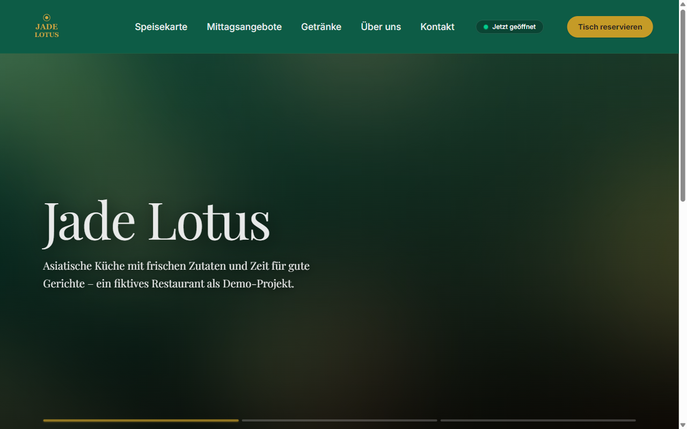
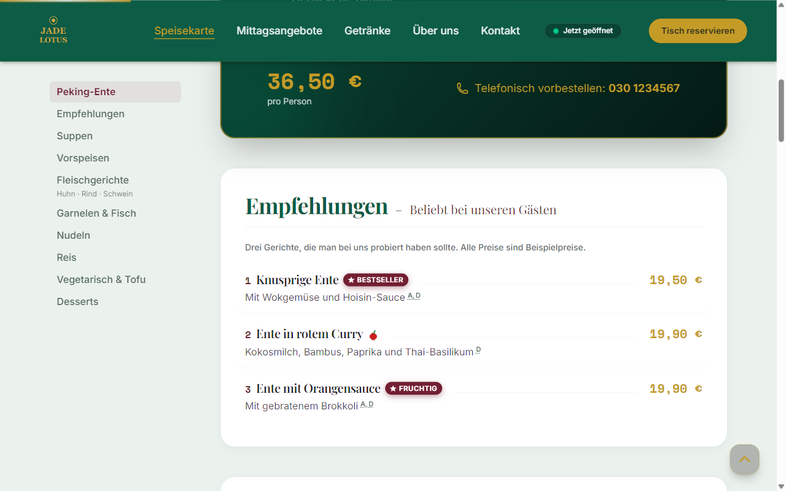
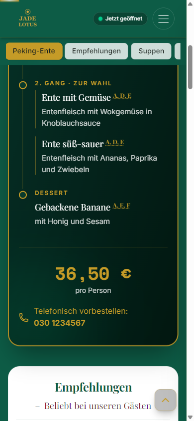

# Jade Lotus – Restaurant-Webseite (anonymisierte Demo)

Relaunch der Webseite eines Restaurants in Berlin, umgesetzt im November 2026 für einen echten Kunden.
**Dieses Repository ist eine anonymisierte Kopie:** Name, Logo, Fotos, Adresse, Kontaktdaten, Impressum und Preise
sind durch Platzhalter ersetzt. Das Restaurant „Jade Lotus“ ist fiktiv.



## Worum es ging

Das Restaurant hatte eine ältere WordPress-Seite. Ziel war eine schnelle, gut lesbare Seite, die vor allem auf dem
Handy funktioniert: Speisekarte, Mittagsangebote, Getränke, Öffnungszeiten, Anfahrt und Reservierung per Anruf.

## Was die Seite kann

- **Interaktive Speisekarte** mit mitlaufender Kategorie-Leiste, Sprung-Chips zu Unterkategorien und
  Markierung der aktuellen Kategorie beim Scrollen
- **Allergene und Zusatzstoffe** direkt am Gericht erklärt (Kürzel antippen), Schärfegrad als Chili-Symbol
- **Live-Status** „Jetzt geöffnet / geschlossen“ nach den Öffnungszeiten
- **Anruf-Buttons nur auf Touch-Geräten**, auf dem Desktop steht die Nummer als Text
- **Datenschutzfreundliche Karte:** Google Maps lädt erst nach Klick, vorher keine Verbindung zu Google
- **SEO:** Sitemap, robots.txt, strukturierte Daten (schema.org „Restaurant“), Vorschaubild für WhatsApp & Co.,
  Weiterleitungen der alten WordPress-Adressen
- **Vorschau-Deploys** auf Netlify sind für Suchmaschinen gesperrt, damit sie nicht mit der echten Domain konkurrieren

| Speisekarte | Handy |
|---|---|
|  |  |

## Wie ich gearbeitet habe

- **Anforderungen** mit dem Inhaber geklärt und die Inhalte der alten Seite und der gedruckten Karte übernommen
- **KI-gestützte Entwicklung** mit Antigravity und Claude: Ich habe beschrieben, was
  die Seite tun soll, die Vorschläge im Browser geprüft und in vielen kleinen Schritten nachgeschärft
  (über 40 Iterationen, z. B. größere Tippflächen auf dem Handy, mehr Kontrast, kompaktere Seitenleiste)
- **Test** auf Desktop, Tablet und Handy
- **Übergabe** an den Kunden als Vorschau über Netlify

## Technik

Next.js 16 (App Router) · React 19 · TypeScript · Tailwind CSS 4 · Hosting auf Netlify

## Lokal starten

```bash
npm install
npm run dev
```

Dann <http://localhost:3000> öffnen.

## Hinweis

Alle Namen, Adressen, Telefonnummern, Bilder und Preise in diesem Repository sind Platzhalter.
Speise-, Getränke- und Mittagskarte sind gekürzte, neu geschriebene Beispielkarten und stimmen nicht mit der Karte des echten Restaurants überein.
